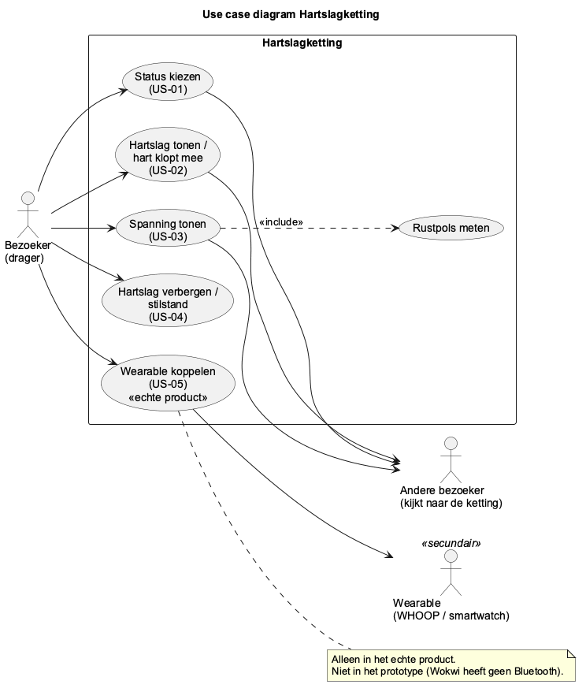
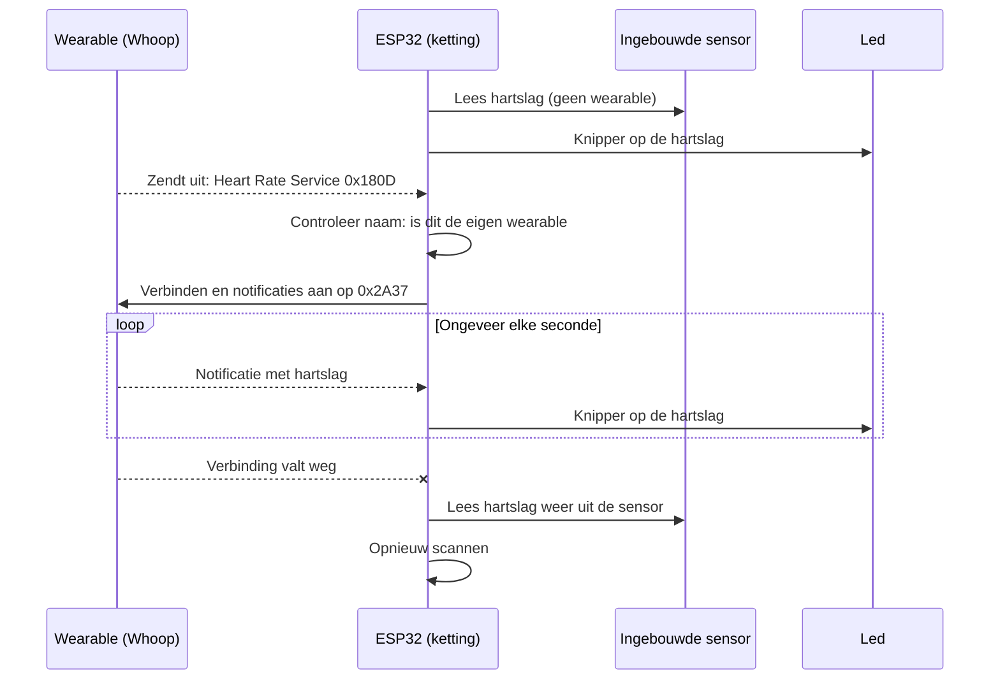
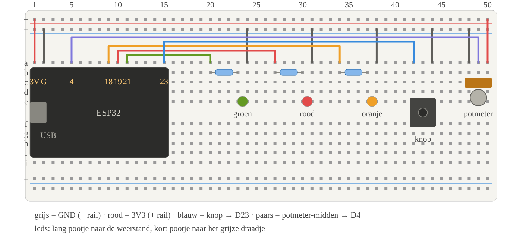
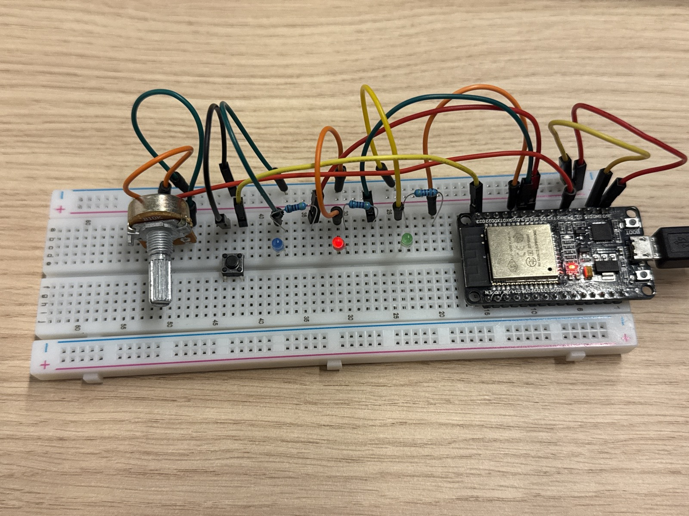
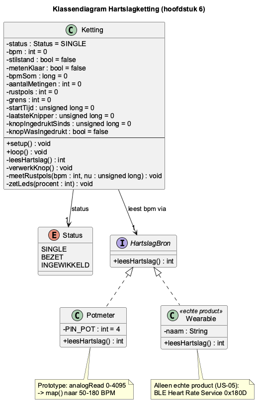
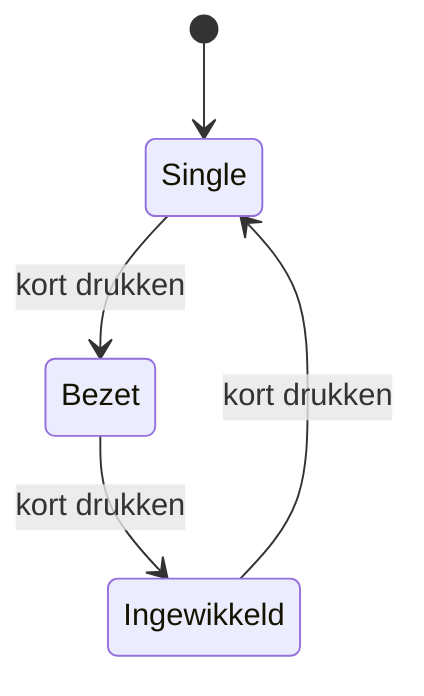
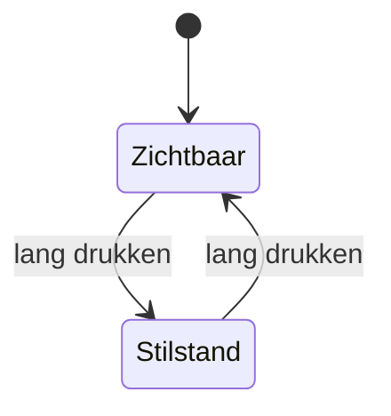
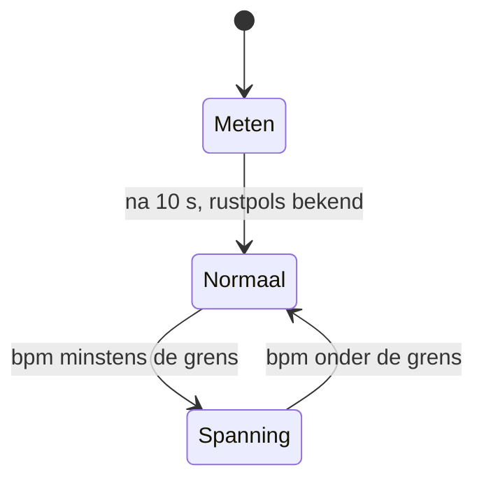
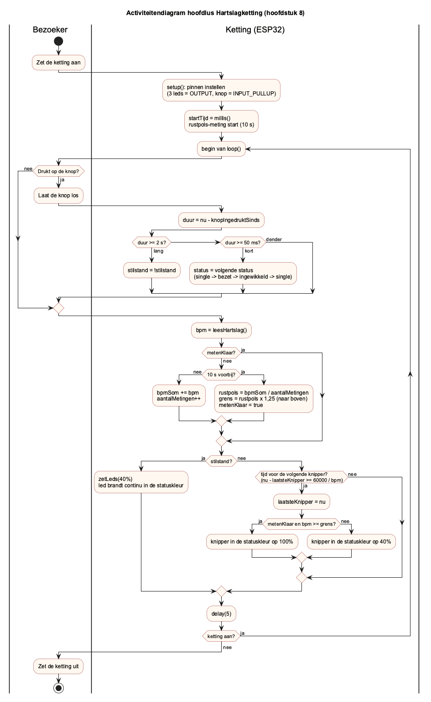
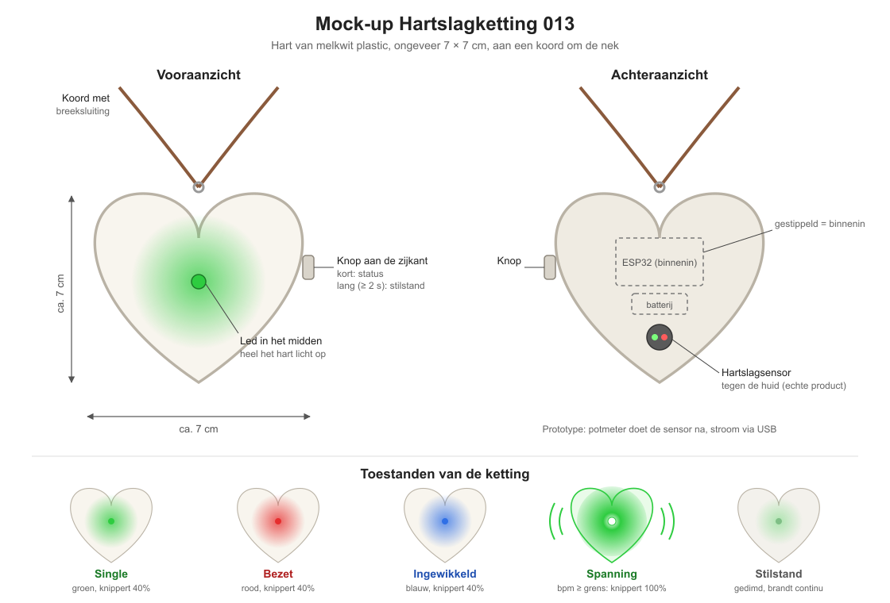

# Ontwerp Hartslagketting 013

Hackathon 6, Niet-zo-single-feestje. Opdrachtgever: Poppodium 013, feest "Smerrig".
Team: Osama en Ahmad.
Versie 0.3: schematechnieken per ontwerplaag (klassendiagram, use case diagram, activiteitendiagram) en mock-up toegevoegd. De derde led is blauw.

## 1. Het idee

Elke bezoeker krijgt een hartketting met een ESP32 erin.
Een led knippert op de hartslag van de drager.
De kleur laat de status zien: single, bezet of ingewikkeld. Die kies je met een knop.
Bij het aanzetten meet de ketting je rustpols. Gaat je hartslag 25% daarboven, dan knippert de led feller.
Wil je je hartslag verbergen? Houd de knop lang in. Dan brandt de led rustig, zonder te knipperen.

In het prototype doet een potmeter de hartslag na.
In het echte product komt de hartslag uit een sensor in de ketting, of uit een gekoppelde Whoop of smartwatch.

## 2. User stories

| Nr | User story | Soort |
|----|------------|-------|
| US-01 | Status kiezen | Eis |
| US-02 | Hart klopt mee | Eis |
| US-03 | Spanning zichtbaar | Eis |
| US-04 | Stilstand | Wens |
| US-05 | Wearable koppelen | Wens, alleen in het echte product |

### US-01: Status kiezen (eis)

Als bezoeker wil ik met een knop mijn status kiezen, zodat anderen zien of ik beschikbaar ben.

- AC-01.1: Kort drukken (korter dan 2 s) wisselt de status: single → bezet → ingewikkeld → single.
- AC-01.2: De led toont groen bij single, rood bij bezet en blauw bij ingewikkeld.
- AC-01.3: Na het aanzetten is de status single.

### US-02: Hart klopt mee (eis)

Als bezoeker wil ik dat mijn ketting knippert op mijn hartslag, zodat het hart echt leeft.

- AC-02.1: Het systeem leest de hartslag uit via de potmeter (GPIO 4), omgerekend naar 50–180 BPM.
- AC-02.2: De led knippert in de statuskleur, met precies één knipper per hartslag (bij 60 BPM is dat één keer per seconde).
- AC-02.3: De hartslag wordt niet opgeslagen en niet verzonden.

Waarom GPIO 4: zie hoofdstuk 5.

### US-03: Spanning zichtbaar (eis)

Als bezoeker wil ik dat mijn ketting laat zien wanneer mijn hartslag stijgt, zodat de ander merkt dat ik iemand leuk vind.

- AC-03.1: Na het aanzetten meet het systeem 10 seconden lang de rustpols (het gemiddelde).
- AC-03.2: Ligt de BPM minstens 25% boven de rustpols, dan knippert de led op maximale helderheid. Daaronder is dat 40%.
- AC-03.3: Zakt de BPM weer onder de grens, dan keert de led binnen 2 seconden terug naar normaal.

### US-04: Stilstand (wens)

Als bezoeker wil ik mijn hartslag kunnen verbergen, zodat ik zelf bepaal wat anderen zien.

- AC-04.1: Lang drukken (langer dan 2 s) zet de stilstand aan of uit.
- AC-04.2: In de stilstand brandt de led continu en gedimd in de statuskleur, zonder te knipperen.

### US-05: Wearable koppelen (wens, alleen in het echte product)

Als bezoeker met een WHOOP of smartwatch wil ik die aan mijn ketting koppelen, zodat mijn hartslag nauwkeuriger is.

- AC-05.1: De ketting leest de hartslag via het standaard BLE-hartslagprofiel.
- AC-05.2: Is er geen wearable gekoppeld, dan gebruikt de ketting de ingebouwde sensor.

### Gebruikersperspectief: use case diagram

Bron: [`diagrammen/usecasediagram.puml`](diagrammen/usecasediagram.puml)

- **Bezoeker (drager)** draagt de ketting en bedient hem met de knop. Hij kiest zijn status (US-01), zijn hart klopt mee (US-02), zijn spanning wordt zichtbaar (US-03) en hij kan zijn hartslag verbergen (US-04). In het echte product kan hij ook zijn wearable koppelen (US-05).
- **Andere bezoeker** bedient niets. Hij kijkt alleen naar de ketting: de kleur (status), het knipperen (hartslag) en de helderheid (spanning). Voor hem is de ketting bedoeld.
- **Wearable (WHOOP of smartwatch)** is een secundaire actor. Hij levert de hartslag via Bluetooth, maar alleen in het echte product (US-05). In het prototype doet de potmeter de hartslag na.

Spanning tonen kan niet zonder rustpols: de grens is rustpols × 1,25. Daarom is *Rustpols meten* een `<<include>>` van *Spanning tonen*.

Een mock-up van de ketting staat in hoofdstuk 9.

## 3. Keuze microcontroller

Wij kiezen de **ESP32**.

| Punt | Arduino Uno | ESP32 |
|------|-------------|-------|
| Bluetooth (US-05) | Niet ingebouwd. Er is een extra module nodig. | Ingebouwd (BLE). |
| Dimmen en mengen van kleuren (PWM) | Kan, op 6 pinnen | Kan, op bijna elke pin |
| Grootte | Groot bord | Kleiner bord, past beter in een ketting |
| Spanning pinnen | 5 V | 3,3 V |
| Simulator | Tinkercad | Wokwi |

Onze reden: voor US-01 tot en met US-04 is geen Bluetooth nodig. Dat zou ook op een Uno kunnen.
Maar US-05 (Whoop of smartwatch koppelen) heeft Bluetooth nodig. Met de ESP32 kan het echte product op hetzelfde bord verder. We hoeven dan niet over te stappen.

Nadelen waar we rekening mee houden:

- De pinnen werken op 3,3 V. Daar passen we de weerstanden op aan (zie hoofdstuk 5).
- Bluetooth kost stroom. Dat speelt pas in het echte product.

## 4. Waar komt de hartslag vandaan

### Eén functie: leesHartslag()

De rest van de code vraagt de hartslag altijd op via `leesHartslag()`.
De functie geeft de bpm terug, tussen 50 en 180.
Reden: de rest van de code hoeft niet te weten waar de hartslag vandaan komt. Wisselen van bron is één aanpassing op één plek.

| Bron | Waar | Hoe |
|------|------|-----|
| Potmeter | Prototype (Wokwi en breadboard) | `analogRead` op GPIO 4 geeft 0 tot 4095. Dat rekenen we om naar 50 tot 180 bpm met `map()`. |
| Ingebouwde sensor | Echte product, zonder wearable | Een hartslagsensor in de ketting. In het prototype doet de potmeter dit na. |
| Whoop of smartwatch | Echte product, met wearable (US-05) | Via Bluetooth, zie hieronder. |

### Wearable koppelen (US-05, echte product)

Dit bouwen we niet in het prototype. In Wokwi werkt Bluetooth niet. We beschrijven het wel, zodat het echte product verder kan.

De Whoop kan zijn hartslag uitzenden met "Broadcast Heart Rate".
Hij gebruikt daarvoor de standaard van Bluetooth: de Heart Rate Service. Smartwatches en hartslagbanden gebruiken dezelfde standaard.
De wearable is de server (hij heeft de gegevens). De ESP32 is de client (hij vraagt de gegevens op).

1. De drager zet in de app van zijn wearable het uitzenden van de hartslag aan.
2. De ESP32 scant naar apparaten met de Heart Rate Service (UUID `0x180D`).
3. De ESP32 controleert de naam. Alleen de wearable van de eigen drager mag door.
4. De ESP32 verbindt en zet notificaties aan op de Heart Rate Measurement characteristic (UUID `0x2A37`).
5. De wearable stuurt nu ongeveer elke seconde een bericht.
6. De ESP32 haalt de bpm uit het bericht. Is bit 0 van de eerste byte een 0, dan staat de bpm in byte 2. Is het een 1, dan staat hij in byte 2 en 3 samen.

Valt de verbinding weg, dan gebruikt de ketting weer de ingebouwde sensor (AC-05.2). Ondertussen scant hij opnieuw.

## 5. Onderdelen en bedrading

Bord: ESP32 DevKit, 30 pinnen. Alles staat op één breadboard.

De ESP32 bedekt op het breadboard kolom b tot en met i. Alleen aan de kant van 3V3 blijft een rij gaatjes vrij (kolom a).
Daarom gebruiken we alleen pinnen aan die kant.

| Onderdeel | Pin ESP32 | Gat ESP-pin | Aansluiting op het breadboard | Waarom deze pin |
|-----------|-----------|-------------|-------------------------------|-----------------|
| Stroom + | 3V3 | a1 | a1 → + rail | |
| Stroom − | GND | a2 | a2 → − rail | |
| Led groen (single) | GPIO 21 | a11 | a11 → a20, weerstand 470 Ω b20–b23, led lang e23, kort e24, a24 → − rail | Gewone uitgang met PWM |
| Led rood (bezet) | GPIO 19 | a10 | a10 → a27, weerstand 470 Ω b27–b30, led lang e30, kort e31, a31 → − rail | Gewone uitgang met PWM |
| Led blauw (ingewikkeld) | GPIO 18 | a9 | a9 → a34, weerstand 470 Ω b34–b37, led lang e37, kort e38, a38 → − rail | Gewone uitgang met PWM |
| Knop | GPIO 23 | a15 | Knop over de middengleuf (e42, f42, e44, f44). a15 → a42, a44 → − rail. `INPUT_PULLUP` | Heeft een interne pull-up |
| Potmeter (hartslag) | GPIO 4 | a5 | Pootjes c48, c49, c50. a48 → − rail, a49 → a5, a50 → + rail | Enige analoge ingang aan de vrije kant |

Bouwtekening: 

Het schema voor Wokwi staat in [`src/hartketting/diagram.json`](../src/hartketting/diagram.json). De code staat in [`src/hartketting/hartketting.ino`](../src/hartketting/hartketting.ino).

Onderbouwing:

- **Pinnen aan één kant.** De ESP32 is zo breed dat hij aan één kant alle gaatjes van het breadboard bedekt. Alle pinnen die we nodig hebben (3V3, GND, GPIO 4, 18, 19, 21 en 23) zitten aan de vrije kant. Zo past alles op één breadboard.
- **Geen strapping pins.** GPIO 0, 2, 5, 12 en 15 bepalen hoe de ESP32 opstart. Hangt daar iets aan, dan start hij soms niet. Die gebruiken we dus niet.
- **3,3 V.** De pinnen van de ESP32 kunnen niet tegen 5 V. De potmeter sluiten we daarom aan op 3V3 en niet op 5V.
- **Drie losse leds in plaats van een RGB-led.** We hadden geen RGB-led, wel losse leds in groen, rood en blauw. Per status brandt één led. Kleuren mengen is dan niet nodig. In het echte product kan het weer één RGB-led worden.
- **Weerstanden van 470 Ω.** Een weerstand beperkt de stroom, zodat de led en de pin niet stuk gaan. We hadden 470 Ω, 1 kΩ en 10 kΩ. 470 Ω is de kleinste en geeft dus het felste licht. Op 3,3 V brandt rood goed, groen en blauw iets zwakker.
- **PWM.** Met PWM gaat een pin heel snel aan en uit. Het oog ziet dat als minder fel. Zo maken we 40% helderheid (US-03, US-04).
- **INPUT_PULLUP.** De pin is zonder indrukken hoog en met indrukken laag. We hebben dan geen losse weerstand nodig voor de knop.
- **GPIO 4 is ADC2.** Aan de vrije kant zit geen ADC1-pin. ADC2 werkt niet betrouwbaar als de radio (wifi, en mogelijk Bluetooth) aan staat. In het prototype gebruiken we geen radio, dus dat is geen probleem. In het echte product komt de hartslag uit de sensor of de wearable (US-05). De sensor sluiten we dan aan op een ADC1-pin, bijvoorbeeld GPIO 36 (VP).
- **Geen buzzer.** Geen enkele user story vraagt om geluid. Op een luid feest hoor je een piep ook niet.

## 6. Gegevens

We slaan niets op. Alles staat alleen in het werkgeheugen en is weg als de ketting uit gaat (AC-02.3).

### Klassendiagram

Bron: [`diagrammen/klassendiagram.puml`](diagrammen/klassendiagram.puml)

De Arduino-code heeft geen echte klassen, maar alle variabelen en functies horen bij één ding: de ketting. Daarom tekenen we ze als één klasse `Ketting` met de variabelen hieronder als attributen en de functies uit de code als methodes. `Status` is een enum, want een ketting heeft altijd precies één van de drie statussen. `HartslagBron` laat zien waarom alles via `leesHartslag()` loopt: in het prototype is de bron de potmeter, in het echte product de sensor of een wearable (US-05), zonder dat de rest van de code verandert.

### Variabelen

| Naam | Type | Startwaarde | Betekenis |
|------|------|-------------|-----------|
| `status` | enum `Status` (SINGLE, BEZET, INGEWIKKELD) | SINGLE | De gekozen status (AC-01.3) |
| `bpm` | int | 0 | Laatste hartslag |
| `stilstand` | bool | false | Is de stilstand aan |
| `metenKlaar` | bool | false | Is de rustpols bekend |
| `bpmSom` | long | 0 | Optelling van alle metingen in de eerste 10 s |
| `aantalMetingen` | int | 0 | Aantal metingen in de eerste 10 s |
| `rustpols` | int | 0 | Gemiddelde hartslag van de eerste 10 s |
| `grens` | int | 0 | rustpols × 1,25, naar boven afgerond |
| `startTijd` | unsigned long | 0 | Tijdstip van het aanzetten, in ms. Hiermee meten we de 10 s |
| `laatsteKnipper` | unsigned long | 0 | Tijdstip van de laatste knipper, in ms |
| `knopIngedruktSinds` | unsigned long | 0 | Tijdstip waarop de knop werd ingedrukt, in ms |
| `knopWasIngedrukt` | bool | false | Was de knop de vorige ronde ingedrukt. Zo zien we het moment van indrukken en loslaten |

### Constanten

| Naam | Waarde | Betekenis |
|------|--------|-----------|
| `BPM_MIN`, `BPM_MAX` | 50, 180 | Bereik van de hartslag (AC-02.1) |
| `MEETTIJD_MS` | 10000 | Hoe lang we de rustpols meten (AC-03.1) |
| `GRENS_FACTOR` | 1.25 | 25% boven de rustpols (AC-03.2) |
| `HELDER_NORMAAL` | 40 | Helderheid in procent, normaal en in stilstand |
| `HELDER_MAX` | 100 | Helderheid in procent, boven de grens |
| `LANG_DRUKKEN_MS` | 2000 | Vanaf hoe lang een druk "lang" is (AC-01.1, AC-04.1) |
| `FLITS_MS` | 100 | Hoe lang de led aan is per knipper |
| `ONTDENDER_MS` | 50 | Een druk korter dan dit telt niet. Zo telt het denderen van de knop niet als druk |
| `PIN_GROEN`, `PIN_ROOD`, `PIN_BLAUW` | 21, 19, 18 | Pinnen van de drie leds |
| `PIN_KNOP`, `PIN_POT` | 23, 4 | Overige pinnen |

Onderbouwing:

- **Constanten met een naam.** Elke waarde uit de acceptatiecriteria staat op één plek. Wil 013 iets anders, dan passen we alleen die constante aan.
- **Tempo.** De tijd tussen twee knippers is 60000 / bpm milliseconden. Bij 60 bpm is dat 1000 ms, dus één knipper per seconde (AC-02.2).
- **Binnen 2 seconden terug (AC-03.3).** We kiezen de helderheid in elke ronde van de lus opnieuw, ongeveer elke 5 ms. Zakt de hartslag onder de grens, dan is de volgende knipper al weer op 40%. De langzaamste hartslag is 50 bpm, dus er zit hooguit 1,2 s tussen twee knippers. Dat is binnen de 2 seconden.
- **Tijdens het meten.** De eerste 10 s is er nog geen grens. De led knippert dan gewoon op 40%.

### Kleuren

| Status | Led | Pin |
|--------|-----|-----|
| Single | Groen | GPIO 21 |
| Bezet | Rood | GPIO 19 |
| Ingewikkeld | Blauw | GPIO 18 |

Per status brandt alleen de led van die status. De andere twee zijn uit.

| Situatie | Helderheid | Knipperen |
|----------|------------|-----------|
| Normaal (onder de grens of nog aan het meten) | 40% | Eén keer per hartslag |
| Spanning (bpm minstens de grens) | 100% | Eén keer per hartslag |
| Stilstand | 40% | Niet, brandt continu |

## 7. Statusdiagram

De ketting houdt drie dingen bij die los van elkaar staan. Daarom drie kleine diagrammen.

### Status (kort drukken)

### Stilstand (lang drukken)

### Hartslag (alleen zichtbaar als de stilstand uit is)

| Toestand | Wat doet de led |
|----------|-----------------|
| Meten | Knippert op de hartslag, 40% |
| Normaal | Knippert op de hartslag, 40% |
| Spanning | Knippert op de hartslag, 100% |
| Stilstand | Brandt continu op 40%, ongeacht de hartslag |

De meting van de rustpols loopt ook door als de stilstand aan staat. Zet je de stilstand weer uit, dan klopt de grens dus nog steeds.

## 8. Activiteitendiagram van de hoofdlus

Bron: [`diagrammen/activiteitendiagram.puml`](diagrammen/activiteitendiagram.puml)

Het diagram heeft twee swimlanes. De bezoeker zet de ketting aan en drukt op de knop. De ketting (ESP32) doet de rest: in `setup()` de pinnen instellen en de meting van de rustpols starten, en daarna steeds opnieuw de lus `loop()`.

Kort of lang drukken bepalen we bij het loslaten. We onthouden wanneer de knop werd ingedrukt en rekenen bij het loslaten uit hoe lang dat duurde.

We gebruiken geen `delay()` voor het knipperen. We kijken met `millis()` of het tijd is voor de volgende knipper.
Reden: tijdens een `delay()` staat de code stil. Dan mist de ketting een druk op de knop.

## 9. De ketting

- **Vorm:** een hart van ongeveer 7 bij 7 cm, aan een koord om de nek. De ESP32 zit in het hart.
- **Led:** in het midden van de voorkant. Daar zien anderen hem het best. Het hart is van melkwit plastic, zodat het hele hart oplicht.
- **Knop:** aan de zijkant. De drager kan hem op de tast vinden, en je drukt hem niet per ongeluk in bij het dansen. Hij moet zowel kort als lang ingedrukt kunnen worden.
- **Ingebouwde sensor (echte product):** aan de achterkant van het hart, tegen de huid.
- **Stroom:** in het prototype via de USB-kabel. In het echte product een kleine batterij in het hart.

Bron: [`mockup-ketting.svg`](mockup-ketting.svg). Links het vooraanzicht met de led en de knop, rechts het achteraanzicht met de sensor. Onderaan de toestanden: single (groen), bezet (rood), ingewikkeld (blauw), spanning (fel) en stilstand (gedimd, knippert niet).

*Het prototype: ESP32, drie statusleds (groen, rood, blauw), knop en potmeter op één breadboard.*

## 10. Privacy, ethiek, veiligheid en toegankelijkheid

### Privacy

| Punt | Wat wij doen |
|------|--------------|
| Hartslag is gezondheidsdata. Volgens de AVG zijn dat bijzondere persoonsgegevens. | In het prototype is het een potmeter, dus geen echte gegevens. In het echte product kiest de drager zelf of hij meedoet. |
| Opslaan en versturen | We slaan niks op en sturen niks door. Geen wifi, geen server, geen app (AC-02.3). |
| Zelf bepalen wat anderen zien | Met de stilstand verbergt de drager zijn hartslag met één lange druk (US-04). |
| Weinig prijsgeven | De led toont geen getal. Alleen het tempo en of je boven je eigen grens zit. |
| De broadcast van een Whoop is niet beveiligd (US-05). Iedereen in de buurt kan de hartslag meelezen. | Dat kunnen wij niet oplossen in de ketting. We vertellen het de drager vooraf. |
| De ketting mag alleen koppelen met de wearable van de eigen drager (US-05). | De ketting verbindt alleen met de naam van de eigen wearable. Andere apparaten in de zaal slaat hij over. |

### Ethiek

- De ketting laat iets van je lichaam zien aan vreemden. Meedoen is daarom vrijwillig, en de stilstand is altijd één druk weg.
- Een felle ketting betekent niet "deze persoon vindt jou leuk". Dat moet 013 duidelijk uitleggen bij de ingang (zie ook hoofdstuk 11).

### Veiligheid

- **Knipperen:** sneller dan 3 keer per seconde kan een aanval geven bij mensen met epilepsie. Ons maximum is 180 bpm, en dat is precies 3 keer per seconde. Daarom mag `BPM_MAX` nooit hoger dan 180.
- **Spanning:** alles werkt op 3,3 V. Dat is ongevaarlijk bij aanraken.
- **Koord:** het koord krijgt een sluiting die los schiet als iemand eraan trekt. Dat is veiliger in een drukke zaal.

### Toegankelijkheid

- **Kleurenblindheid:** groen (single) en rood (bezet) zijn voor mensen met de meest voorkomende kleurenblindheid lastig uit elkaar te houden. Dat is een zwak punt (zie hoofdstuk 11). Ingewikkeld is blauw; dat kunnen ook kleurenblinden goed onderscheiden.
- **Spanning zonder kleur:** of iemand boven zijn grens zit, zie je aan de helderheid. Dat werkt ook voor kleurenblinden.
- **Knop:** één knop die je op de tast kunt vinden. Er is geen scherm of app nodig.

## 11. Bekende zwakke punten

| Zwak punt | Wat betekent het | Mogelijke oplossing |
|-----------|------------------|---------------------|
| Op een feest is de hartslag ook hoog door dansen. | Fel betekent niet altijd "verliefd". Op de dansvloer is bijna iedereen fel. | De rustpols helpt een beetje, want iedereen heeft zijn eigen grens. Een hogere `GRENS_FACTOR` helpt ook. |
| De rustpols wordt alleen bij het aanzetten gemeten. | Ben je dan net binnen na het fietsen, dan is de rustpols te hoog en wordt de ketting bijna nooit fel. | Aanzetten bij de ingang, na even stil staan. Of opnieuw meten met een extra knopbediening. |
| Rood en groen zijn lastig voor kleurenblinden. | Single en bezet kunnen worden verward. Dat is de belangrijkste informatie. | De derde led is al blauw (ingewikkeld). Blauw is voor de meeste kleurenblinden goed te onderscheiden van rood en groen. Dat helpt, maar lost het verschil tussen single en bezet niet op. Daarvoor: bezet blauw maken, of na een korte druk 1, 2 of 3 keer knipperen. Bespreken met 013. |
| Het verschil tussen 40% en 100% is in een zaal met veel licht lastig te zien. | Spanning valt minder op dan bedoeld. | Testen in fase 3. Eventueel 20% in plaats van 40%. |
| Een sensor in een ketting meet niet goed. | De ketting hangt los en beweegt bij het dansen. De hartslag is dan onbetrouwbaar. | Daarom US-05: een wearable om de pols meet beter. |
| Niet elke bezoeker heeft een Whoop of smartwatch. | Zonder wearable is alleen de ingebouwde sensor er. | Is afgedekt door AC-05.2. |
| Bluetooth kost stroom. | De batterij moet een hele avond meegaan. | Meten in het echte product. |
| Hoge rustpols geeft een onbereikbare grens (issue #18). | Vanaf een rustpols van 145 BPM komt de grens boven 180 BPM uit (145 × 1,25 = 182). De hartslag gaat niet hoger dan `BPM_MAX` = 180, dus de ketting kan nooit fel worden. | De grens begrenzen op `BPM_MAX`. Of de rustpols opnieuw meten. |

## 12. Akkoord opdrachtgever

| Datum | Naam opdrachtgever | Versie ontwerp | Opmerkingen | Akkoord (ja/nee) | Handtekening |
|-------|--------------------|----------------|-------------|------------------|--------------|
| | | | | | |

Te melden bij akkoord:

- AC-02.1 is aangepast: de potmeter zit op GPIO 4 in plaats van A0.
- Drie losse leds in plaats van een RGB-led.
- Ingewikkeld is blauw in plaats van oranje.
