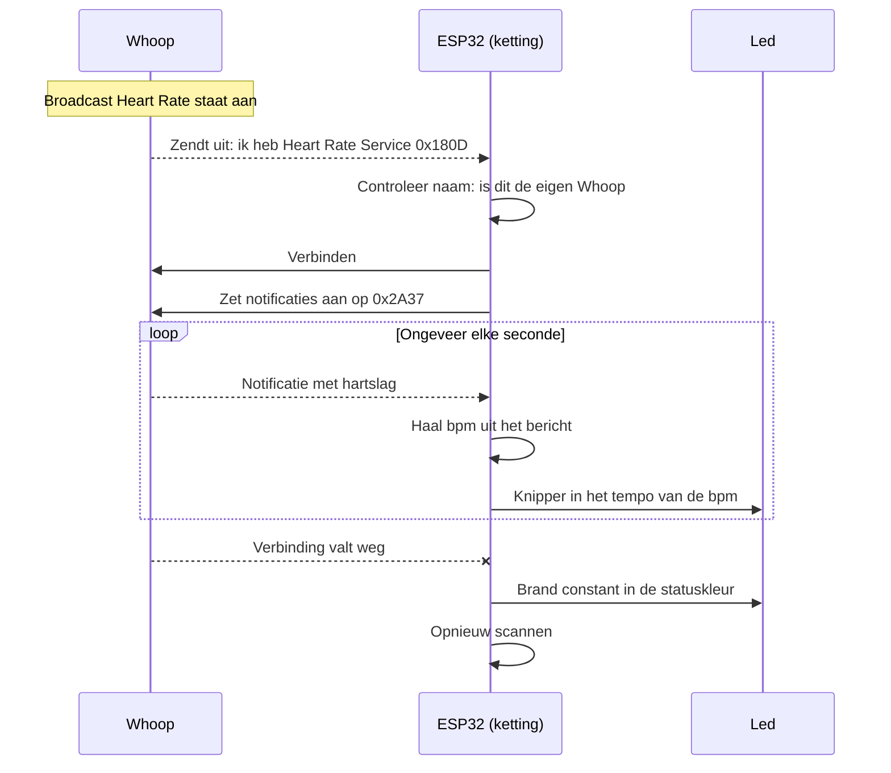
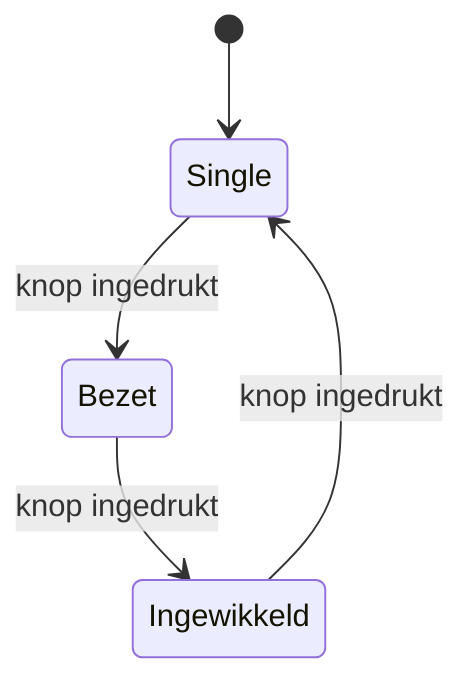
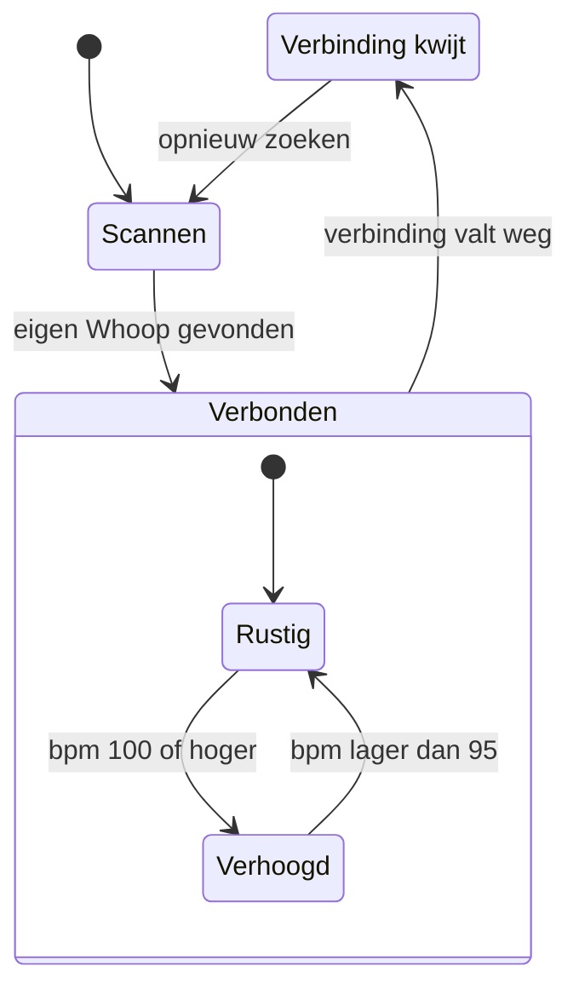
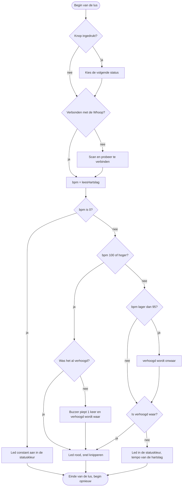

# Ontwerp Hartslagketting 013

Hackathon 6, Niet-zo-single-feestje. Opdrachtgever: Poppodium 013, feest "Smerrig".
Team: Osama en Ahmad.

## 1. Het idee

Elke bezoeker krijgt een hartketting met een ESP32 erin.
De ketting leest de echte hartslag van de drager uit zijn Whoop, via Bluetooth.
Een led knippert in het tempo van die hartslag.
De kleur laat de status zien: single, bezet of ingewikkeld. Die kies je met een knop.
Komt de hartslag boven de 100 bpm? Dan wordt de led rood en knippert hij snel.

Zo zie je in één blik of iemand single is, en of zijn hart sneller gaat kloppen.

## 2. User stories

| Nr | Als | wil ik | zodat | Prioriteit |
|----|-----|--------|-------|------------|
| 1 | bezoeker | met een knop mijn status kiezen (single, bezet, ingewikkeld) | anderen aan de kleur zien of ik open sta voor contact | Must |
| 2 | bezoeker | dat de led knippert in het tempo van mijn hartslag | mijn ketting echt bij mij hoort en leeft | Must |
| 3 | bezoeker | dat de led rood wordt en snel knippert boven 100 bpm | anderen zien dat mijn hart sneller klopt | Must |
| 4 | bezoeker | dat de ketting zelf verbindt met mijn Whoop | ik op het feest niks hoef in te stellen | Must |
| 5 | bezoeker | dat de ketting mijn statuskleur blijft tonen als de verbinding wegvalt | mijn status altijd zichtbaar is | Should |
| 6 | bezoeker | één korte piep horen als ik over de grens ga | ik het merk zonder naar mijn ketting te kijken | Could |

## 3. Keuze microcontroller

Wij kiezen de **ESP32**.

| Punt | Arduino Uno | ESP32 |
|------|-------------|-------|
| Bluetooth | Niet ingebouwd. Er is een extra module nodig. | Ingebouwd (BLE). |
| Grootte | Groot bord. | Kleiner bord, past beter in een ketting. |
| Spanning pinnen | 5 V | 3,3 V |
| Simulator | Tinkercad | Wokwi |

Onze reden: de Whoop stuurt de hartslag via Bluetooth (BLE). De ESP32 heeft dat ingebouwd.
Bij een Uno hebben we een extra Bluetooth-module nodig. Dat is meer bedrading en meer wat stuk kan gaan.

Nadelen van de ESP32 waar we rekening mee houden:

- De pinnen werken op 3,3 V. Daar passen we de weerstanden op aan (zie hoofdstuk 5).
- Draadloze gegevens zijn gevoelig voor privacy (zie hoofdstuk 10).
- Bluetooth kost stroom. De batterij gaat minder lang mee.

## 4. Koppeling met de Whoop

De Whoop kan zijn hartslag uitzenden met de functie "Broadcast Heart Rate".
Hij gebruikt daarvoor de standaard van Bluetooth: de Heart Rate Service.
Daardoor hoeven wij geen app of account van Whoop te gebruiken.

De Whoop is de server (hij heeft de gegevens). De ESP32 is de client (hij vraagt de gegevens op).

### Stappen

1. De drager zet in de Whoop-app "Broadcast Heart Rate" aan.
2. De ESP32 scant naar apparaten met de Heart Rate Service (UUID `0x180D`).
3. De ESP32 controleert de naam van het apparaat. Alleen de Whoop van de eigen drager mag door.
4. De ESP32 verbindt met de Whoop.
5. De ESP32 zet notificaties aan op de Heart Rate Measurement characteristic (UUID `0x2A37`).
6. De Whoop stuurt nu zelf een bericht bij elke nieuwe meting, ongeveer één keer per seconde.
7. De ESP32 haalt de bpm uit het bericht en bewaart die in een variabele.

### De bpm uit het bericht halen

Het bericht bestaat uit bytes. De eerste byte bevat instellingen (flags).

- Is bit 0 van de eerste byte een 0? Dan staat de bpm in byte 2 (één byte).
- Is bit 0 een 1? Dan staat de bpm in byte 2 en 3 samen (twee bytes).

Dit is zo vastgelegd in de Bluetooth-standaard. Daarom werkt het ook met andere hartslagmeters.

### Sequentiediagram

### Als de verbinding wegvalt

- De led stopt met knipperen. Hij brandt constant in de statuskleur.
- De ESP32 gaat opnieuw scannen. Vindt hij de Whoop weer, dan verbindt hij vanzelf.
- De knop blijft werken. De status kiezen kan dus altijd.

Hetzelfde gebeurt als de Whoop 0 bpm stuurt. Dan zit hij niet goed om de pols.
Reden: we laten liever geen hartslag zien dan een verkeerde hartslag.

### Eén functie: leesHartslag()

De rest van de code vraagt de hartslag altijd op via `leesHartslag()`.
De functie geeft de bpm terug. Is er geen hartslag bekend, dan geeft hij 0 terug.
Reden: de rest van de code hoeft niet te weten waar de hartslag vandaan komt. Wisselen van bron is dan één aanpassing op één plek.

### Reserve: Wokwi met een potmeter

In Wokwi werkt Bluetooth niet. Daar doet een potmeter de hartslag na.
`leesHartslag()` leest dan de potmeter en rekent de waarde om naar 50 tot 180 bpm.
Met één constante (`GEBRUIK_POTMETER`) kiezen we tussen de Whoop en de potmeter.
Zo kunnen we de led, de knop en de grens testen zonder Whoop.

## 5. Onderdelen en bedrading

Bord: ESP32 DevKit (30 of 38 pinnen).

| Onderdeel | Pin ESP32 | Aansluiting | Waarom deze pin |
|-----------|-----------|-------------|-----------------|
| RGB-led, rood | GPIO 25 | Via weerstand 220 Ω naar de rode poot | Gewone uitgang, geen strapping pin |
| RGB-led, groen | GPIO 26 | Via weerstand 100 Ω naar de groene poot | Gewone uitgang, geen strapping pin |
| RGB-led, blauw | GPIO 27 | Via weerstand 100 Ω naar de blauwe poot | Gewone uitgang, geen strapping pin |
| RGB-led, lange poot | GND | Direct naar GND (common cathode) | |
| Knop | GPIO 33 | Andere kant van de knop naar GND. `INPUT_PULLUP` | Heeft een interne pull-up |
| Buzzer (passief) | GPIO 18 | Plus naar GPIO 18, min naar GND | Gewone uitgang, geen strapping pin |
| Potmeter (reserve) | GPIO 34 | Buitenste poten naar 3V3 en GND, middelste naar GPIO 34 | ADC1, alleen ingang |

(nog toevoegen: bedradingsschema uit Wokwi en een foto van het breadboard)

Onderbouwing:

- **Geen strapping pins.** GPIO 0, 2, 5, 12 en 15 bepalen hoe de ESP32 opstart. Hangt daar iets aan, dan start hij soms niet. Die gebruiken we dus niet.
- **3,3 V.** De pinnen van de ESP32 geven 3,3 V en kunnen niet tegen 5 V. De potmeter sluiten we daarom aan op 3V3 en niet op 5V.
- **Weerstanden.** Een weerstand beperkt de stroom, zodat de led en de pin niet stuk gaan. Rood heeft ongeveer 2 V nodig, groen en blauw ongeveer 3 V. Bij 3,3 V blijft er voor groen en blauw weinig over. Daarom krijgen zij een kleinere weerstand (100 Ω) dan rood (220 Ω). Anders branden ze te zwak.
- **INPUT_PULLUP.** De pin is zonder indrukken hoog en met indrukken laag. We hebben dan geen losse weerstand nodig voor de knop.
- **ADC1 voor de potmeter.** De ESP32 heeft twee groepen analoge ingangen. ADC2 deelt hardware met de radio van de ESP32. ADC1 heeft daar geen last van. GPIO 34 hoort bij ADC1.
- **Passieve buzzer.** Die sturen we aan met `tone()`. Zo kiezen we zelf de toonhoogte en de lengte van de piep.

## 6. Gegevens

We slaan niets op. Alles staat alleen in het werkgeheugen en is weg als de ketting uit gaat.

### Variabelen

| Naam | Type | Startwaarde | Betekenis |
|------|------|-------------|-----------|
| `status` | enum `Status` (SINGLE, BEZET, INGEWIKKELD) | SINGLE | De gekozen status |
| `bpm` | int | 0 | Laatste hartslag. 0 betekent: geen hartslag bekend |
| `verbonden` | bool | false | Is er verbinding met de Whoop, ja of nee |
| `verhoogd` | bool | false | Is de hartslag boven de grens |
| `laatsteKnipper` | unsigned long | 0 | Tijdstip van de laatste knipper, in milliseconden |

### Constanten

| Naam | Waarde | Betekenis |
|------|--------|-----------|
| `GRENS_BPM` | 100 | Vanaf deze hartslag is het "verhoogd" |
| `GRENS_TERUG_BPM` | 95 | Onder deze hartslag is het weer "rustig" |
| `KNIPPER_SNEL_MS` | 400 | Tijd tussen twee knippers bij verhoogd (2,5 keer per seconde) |
| `FLITS_MS` | 100 | Hoe lang de led aan is per knipper |
| `ONTDENDER_MS` | 50 | Wachttijd tegen het denderen van de knop |
| `WHOOP_NAAM` | (naam van onze Whoop) | Alleen met dit apparaat verbinden we |
| `GEBRUIK_POTMETER` | false | true = potmeter (Wokwi), false = Whoop |
| `PIN_ROOD`, `PIN_GROEN`, `PIN_BLAUW` | 25, 26, 27 | Pinnen van de led |
| `PIN_KNOP`, `PIN_BUZZER`, `PIN_POTMETER` | 33, 18, 34 | Overige pinnen |

Onderbouwing:

- **Constanten met een naam.** De grens staat op één plek. Willen we hem aanpassen, dan hoeft dat maar één keer.
- **Twee grenzen (100 en 95).** Schommelt de hartslag rond de 100, dan zou de led steeds wisselen en de buzzer steeds piepen. Nu wordt het pas weer rustig onder de 95.
- **Tempo bij rustig.** De tijd tussen twee knippers is 60000 / bpm milliseconden. Bij 60 bpm is dat 1000 ms, dus één knipper per seconde.

### Kleuren

| Situatie | Kleur | Rood | Groen | Blauw | Knipperen |
|----------|-------|------|-------|-------|-----------|
| Single | Groen | uit | aan | uit | Tempo van de hartslag |
| Bezet | Blauw | uit | uit | aan | Tempo van de hartslag |
| Ingewikkeld | Geel | aan | aan | uit | Tempo van de hartslag |
| Hartslag verhoogd | Rood | aan | uit | uit | Snel, vast tempo (2,5 keer per seconde) |
| Geen verbinding of geen hartslag | Statuskleur | | | | Niet, brandt constant |

Rood is alleen voor de hoge hartslag. Geen enkele status is rood. Zo is rood altijd duidelijk.

## 7. Statusdiagram

De ketting houdt twee dingen tegelijk bij. Daarom twee kleine diagrammen.

### Status (via de knop)

### Verbinding en hartslag

| Toestand | Wat doet de led |
|----------|-----------------|
| Scannen | Brandt constant in de statuskleur |
| Verbonden, rustig | Knippert in de statuskleur, in het tempo van de hartslag |
| Verbonden, verhoogd | Knippert rood en snel. De buzzer piept één keer bij het ingaan |
| Verbinding kwijt | Brandt constant in de statuskleur |

De knop werkt in elke toestand. De status en de verbinding staan los van elkaar.

## 8. Activiteitendiagram van de hoofdlus

We gebruiken geen `delay()` voor het knipperen. We kijken met `millis()` of het tijd is voor de volgende knipper.
Reden: tijdens een `delay()` staat de code stil. Dan mist de ketting een druk op de knop.

In Wokwi slaan we de stap "Verbonden met de Whoop?" over. De rest van de lus is gelijk.

## 9. De ketting

- **Vorm:** een hart van ongeveer 7 bij 7 cm, aan een koord om de nek. De ESP32 zit in het hart.
- **Led:** in het midden van de voorkant. Daar zien anderen hem het best. Het hart is van melkwit plastic, zodat het hele hart oplicht.
- **Knop:** aan de zijkant. De drager kan hem op de tast vinden, en je drukt hem niet per ongeluk in bij het dansen.
- **Buzzer:** aan de binnenkant.
- **Stroom:** in het prototype via de USB-kabel. In het echte product een kleine batterij in het hart.
- **Whoop:** zit om de pols van de drager. Hij is geen deel van de ketting.

(nog toevoegen: schets van de ketting met de plek van de led en de knop)

(nog toevoegen: foto van het prototype)

## 10. Privacy, ethiek, veiligheid en toegankelijkheid

### Privacy

| Punt | Wat wij doen |
|------|--------------|
| Hartslag is gezondheidsdata. Volgens de AVG zijn dat bijzondere persoonsgegevens. | De drager kiest zelf. Hij zet de broadcast zelf aan in zijn Whoop-app. Zonder dat doet de ketting niks met hartslag. |
| Opslaan | We slaan niks op. De bpm staat alleen in het werkgeheugen en is weg als de ketting uit gaat. |
| Versturen | De ketting stuurt niks door. Geen wifi, geen server, geen app. |
| De broadcast van de Whoop is niet beveiligd. Iedereen in de buurt met een Bluetooth-app kan de hartslag lezen. | Dit kunnen wij niet oplossen in de ketting. We vertellen het de drager vooraf. Na het feest zet hij de broadcast weer uit. |
| De ketting mag alleen koppelen met de Whoop van de eigen drager. | De ketting verbindt alleen met de naam in `WHOOP_NAAM`. Een andere Whoop in de zaal slaat hij over. |

### Ethiek

- De ketting laat iets van je lichaam zien aan vreemden. Meedoen is daarom vrijwillig.
- De led toont geen getal, alleen rustig of verhoogd. Zo geven we zo min mogelijk prijs.
- Een rode ketting betekent niet "deze persoon vindt jou leuk". Dat moet 013 duidelijk uitleggen bij de ingang (zie ook hoofdstuk 11).

### Veiligheid

- **Knipperen:** de led knippert nooit sneller dan 3 keer per seconde. Sneller knipperen kan een aanval geven bij mensen met epilepsie. Ons snelste tempo is 2,5 keer per seconde.
- **Spanning:** alles werkt op 3,3 V. Dat is ongevaarlijk bij aanraken.
- **Koord:** het koord krijgt een sluiting die los schiet als iemand eraan trekt. Dat is veiliger in een drukke zaal.
- **Buzzer:** piept één keer kort, niet doorlopend.

### Toegankelijkheid

- **Kleurenblindheid:** verhoogd herken je niet alleen aan rood, maar ook aan het snelle tempo. Dat werkt ook als je rood en groen niet uit elkaar kunt houden.
- De drie statuskleuren zijn voor kleurenblinden wel lastig (groen en geel lijken op elkaar). Dit is een zwak punt, zie hoofdstuk 11.
- **Knop:** één grote knop die je op de tast kunt vinden. Er is geen scherm of app nodig.

## 11. Bekende zwakke punten

| Zwak punt | Wat betekent het | Mogelijke oplossing |
|-----------|------------------|---------------------|
| Op een feest is de hartslag ook hoog door dansen. | Rood betekent niet altijd "verliefd". Op de dansvloer is bijna iedereen rood. | De grens hoger zetten (één constante). Of de grens per persoon bepalen vanaf de rusthartslag. |
| Niet elke bezoeker heeft een Whoop. | Zonder Whoop werkt alleen de statuskleur. | Een hartslagsensor in de ketting zelf. Of andere hartslagbanden toelaten: die gebruiken dezelfde Bluetooth-standaard. |
| De naam van de Whoop staat vast in de code. | Voor elke ketting moet de naam apart worden ingesteld. Dat kan niet bij honderden bezoekers. | Koppelen bij de ingang: de ketting kiest de Whoop die er het dichtst bij is. |
| De broadcast is niet beveiligd. | Anderen kunnen de hartslag meelezen. | Kunnen wij niet oplossen. Wel uitleggen aan de drager. |
| Statuskleuren zijn lastig voor kleurenblinden. | Groen (single) en geel (ingewikkeld) lijken op elkaar. | Na een druk op de knop 1, 2 of 3 keer knipperen. Of een symbool per status op de ketting. |
| De buzzer hoor je bijna niet op een luid feest. | De piep heeft weinig nut in de zaal. | Daarom is de buzzer optioneel. Een trilmotor zou beter werken. |
| Bluetooth kost stroom. | De batterij moet een hele avond meegaan. Dat hebben we niet getest. | Meten in fase 3. |

## 12. Akkoord opdrachtgever

| Datum | Naam opdrachtgever | Versie ontwerp | Opmerkingen | Akkoord (ja/nee) | Handtekening |
|-------|--------------------|----------------|-------------|------------------|--------------|
| | | | | | |
